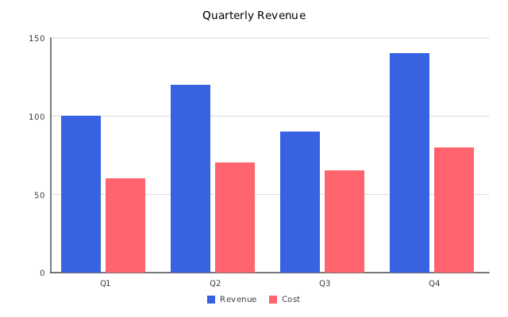
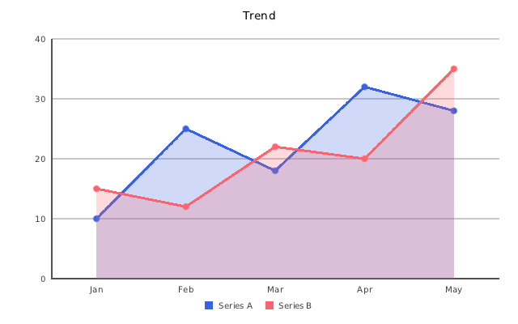
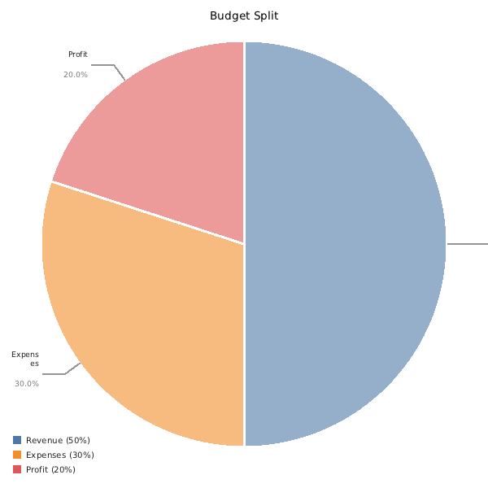
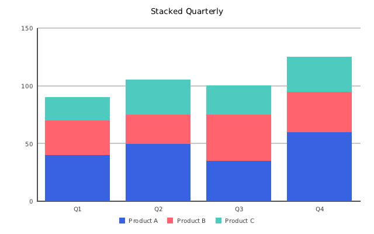
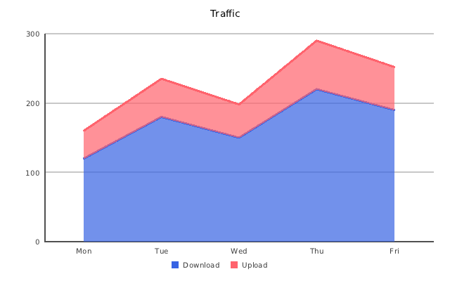
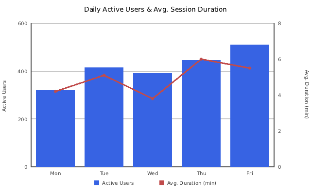
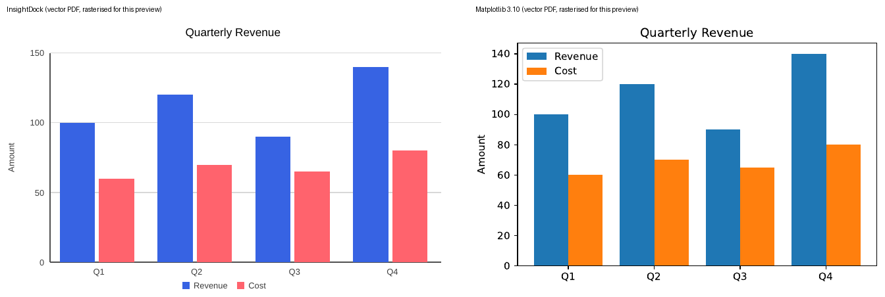

<h1 align="center">InsightDock Charts for C++</h1>

<p align="center">
  <b>Native C++17 charts for reports and embedded devices.</b><br>
  PNG, JPEG, and native vector SVG and PDF from one call. MIT-licensed, no GUI toolkit, no Python.
</p>

<p align="center">
  <a href="https://github.com/aavazir/insightdock-charts/actions/workflows/ci.yml"></a>
  <a href="https://aavazir.github.io/insightdock-charts/"></a>
  <a href="LICENSE"></a>
  
  
</p>

<p align="center">
  <a href="https://aavazir.github.io/insightdock-charts/">Documentation</a> ·
  <a href="https://aavazir.github.io/insightdock-charts/getting-started/">Getting started</a> ·
  <a href="https://aavazir.github.io/insightdock-charts/examples/">Examples</a> ·
  <a href="docs/COMPARISON.md">Comparison</a> ·
  <a href="CHANGELOG.md">Changelog</a>
</p>

<p align="center">
  
  
  
</p>

## Why InsightDock

- **Reports and servers, not GUIs.** Render from a daemon, CLI tool, container or router. No window, no Qt, no Python, no Gnuplot.
- **Real vector output.** SVG and PDF contain native paths and selectable text for pie, bar, line, area and combo charts, so they stay sharp at any zoom or print size.
- **Small and portable.** The core needs only the C++17 standard library; stb headers are vendored. A Make build for OpenWrt lets you drop chart types, JPEG and the embedded font.
- **Deterministic.** The same data gives the same chart on every machine, using an embedded font.
- **MIT.** No license keys, no copyleft.

InsightDock is static output only. For interactive zoom and pan use QCustomPlot, ImPlot or Qt Charts. See the [honest comparison](docs/COMPARISON.md).

## Quick start

```cpp
#include "insightdock/charts.h"

using namespace insightdock::charts;

BarChart bar;
bar.options().title = "Quarterly Revenue";
bar.set_categories({"Q1", "Q2", "Q3", "Q4"});
bar.add_series("Revenue", {100, 120, 90, 140});
bar.add_series("Cost", {60, 70, 65, 80});

ChartExporter::save(bar, "revenue.png");   // format inferred from the extension
```

Native vector output:

```cpp
ExportOptions opts;
opts.svg_backend = SvgBackend::Vector;     // SVG: no dependencies
opts.pdf_backend = PdfBackend::Vector;     // PDF: needs INSIGHTDOCK_WITH_PODOFO
ChartExporter::save(bar, "revenue.svg", opts);
ChartExporter::save(bar, "revenue.pdf", opts);
```

Link it from CMake:

```cmake
find_package(InsightDock CONFIG REQUIRED)
target_link_libraries(myapp PRIVATE InsightDock::Charts)
```

See [examples/](examples/) for pie, bar, line, combo, scatter, log-scale, time-series and PDF report samples.

## Features

- **Charts:** pie/doughnut, bar (grouped, stacked, 100%-stacked, horizontal), line (area fill, step, spline), area (stacked, 100%), combo with a second y-axis, scatter/bubble, histogram
- **Axes:** linear, logarithmic, and a date/time x-axis positioned by real timestamp
- **Styling:** three palettes (Chart.js, Tableau-10, colorblind-safe), per-series dash, marker, width and opacity, reference lines, gap handling for missing values, multi-line titles
- **Text:** UTF-8; embedded ASCII font, optional Latin-1/Latin-Ext font, or any TTF via `ChartOptions::font`
- **Output:** PNG, JPEG, SVG, PDF and a raw RGBA `ImageBuffer`; multi-page PDF report builder (PoDoFo)
- **Robust:** non-finite and hostile input is handled without hangs; CI runs ASan/UBSan, and unit tests feed NaN, Inf and oversized input to every chart type
- **Thread-safe export:** concurrent `render()`/`save()` on a const chart is supported

## Gallery

| Pie | Bar (stacked) | Area (stacked) |
|---|---|---|
|  |  |  |

| Combo (bar + line, dual axis) | Vector PDF vs Matplotlib |
|---|---|
|  |  |

More in [docs/gallery/](docs/gallery/).

## Project layout

```
├── include/insightdock/       Public headers (charts.h umbrella)
│   └── pdf/                   PoDoFo PDF helpers (podofo.h)
├── src/                       Library implementation
├── examples/                  Generic sample programs
├── tests/                     CTest smoke tests
├── third_party/               stb headers (header-only)
├── docs/                      API, release, gallery, benchmarks
└── cmake/                     Package config for install
```

## Building

### Host (Make) — core only

Best for OpenWrt and minimal embedded builds:

```bash
make
./bar_line_example
./example_main
```

Three variables let you trim the library for size-constrained targets:

| Variable | Default | Options | Effect |
|---|---|---|---|
| `CHART_TYPES` | `pie bar line area scatter` | any subset (`bar`+`line` also builds combo) | Omitted types are not compiled |
| `EXPORT_FORMATS` | `png jpeg` | `png` or `png jpeg` | Omitting `jpeg` drops ~15 KB |
| `FONT_MODE` | `embedded` | `embedded` \| `embedded-latin` \| `system` | `embedded-latin` adds Latin-1/Latin-Ext glyphs (~22 KB); `system` drops the baked-in font |

**Minimal OpenWrt build** (pie only, PNG only, system font from `/www/assets/`):

```bash
make CXX=mips-openwrt-linux-musl-g++ AR=mips-openwrt-linux-musl-gcc-ar \
     CHART_TYPES="pie" EXPORT_FORMATS="png" FONT_MODE=system \
     CXXFLAGS="-std=c++17 -Os -ffunction-sections -fdata-sections -Wall"
```

When `FONT_MODE=system`, no font is baked in, so supply one on every chart:

```cpp
static auto font = insightdock::charts::load_font_data("/www/assets/fonts/OpenSans-Regular.ttf");
chart.options().font = font;   // shared_ptr — reuse it across charts
```

| Configuration | Code section (unstripped) |
|---|---|
| Full default (all types, embedded font, JPEG) | ~287 KB |
| Minimal (pie + PNG + system font) | ~90 KB |
| Minimal with `-Os -s` strip (estimated) | ~45–55 KB |

Cross-compile (full build):

```bash
make CXX=mips-openwrt-linux-musl-g++ AR=mips-openwrt-linux-musl-gcc-ar
```

Packaging this into an OpenWrt feed: [packaging/openwrt/](packaging/openwrt/) has a standard
`package.mk`-based feed `Makefile` sample wired to these same `CHART_TYPES`/`EXPORT_FORMATS`/
`FONT_MODE` knobs.

### CMake (recommended)

```bash
cmake -B build \
  -DINSIGHTDOCK_BUILD_EXAMPLES=ON \
  -DINSIGHTDOCK_BUILD_TESTS=ON
cmake --build build
ctest --test-dir build
```

| Option | Default | Description |
|--------|---------|-------------|
| `INSIGHTDOCK_BUILD_EXAMPLES` | ON | Build generic examples |
| `INSIGHTDOCK_WITH_PODOFO` | OFF | PDF adapter + PDF examples |
| `INSIGHTDOCK_BUILD_TESTS` | ON | CTest smoke tests |
| `INSIGHTDOCK_WERROR` | OFF | `-Werror` (keep OFF for cross-toolchains) |
| `INSIGHTDOCK_PODOFO_DIR` | `../podofo` | PoDoFo source tree (subproject) or install |

### CMake + PoDoFo (PDF)

PoDoFo requires **CMake 3.23+**. On older systems:

```bash
pip install --user 'cmake>=3.23'
export PATH="$HOME/.local/bin:$PATH"
```

```bash
cmake -B build-podofo \
  -DINSIGHTDOCK_WITH_PODOFO=ON \
  -DINSIGHTDOCK_BUILD_EXAMPLES=ON \
  -DINSIGHTDOCK_PODOFO_DIR=/path/to/podofo
cmake --build build-podofo
export LD_LIBRARY_PATH="$(pwd)/build-podofo/podofo/target:${LD_LIBRARY_PATH}"
./build-podofo/podofo_report_example
```

### Install and consume

```bash
cmake --install build --prefix /opt/insightdock
```

```cmake
find_package(InsightDock CONFIG REQUIRED)
target_link_libraries(myapp PRIVATE InsightDock::Charts)
```

```cpp
#include "insightdock/charts.h"
```

A `pkg-config` file (`insightdock.pc`) is also installed to `lib/pkgconfig/`, for Meson or
plain-Makefile consumers:

```bash
export PKG_CONFIG_PATH="/opt/insightdock/lib/pkgconfig:${PKG_CONFIG_PATH}"
g++ -std=c++17 $(pkg-config --cflags --libs insightdock) myapp.cc -o myapp
```

Note: pass `-DCMAKE_INSTALL_PREFIX=/opt/insightdock` at the `cmake -B build` configure step (not
just `cmake --install build --prefix ...`) so the generated `.pc` file's paths match where the
library actually ends up — `configure_file()` bakes `CMAKE_INSTALL_PREFIX` at configure time.

## Platform support

| Platform | Core (PNG/JPEG) | PDF (PoDoFo) |
|----------|-----------------|--------------|
| Linux distros | Yes (CMake + Make) | Yes (optional) |
| OpenWrt / cross | Yes (Make, no GUI deps) | Yes — verified on OpenWrt x86_64/musl, `BUILD_SHARED_LIBS=ON` with PoDoFo packaged separately |
| macOS | CMake (CI) | Optional |
| Windows | CMake + MSVC (CI; static and DLL) | Optional |

## Documentation

The full documentation is at **https://aavazir.github.io/insightdock-charts/**: getting started, concepts, guides (usage, vector export, PDF reports, fonts, thread safety and ABI, troubleshooting), one page per chart type, examples, the generated API reference, a comparison and the changelog.

In the repository: [docs/API.md](docs/API.md) (usage guide), [docs/BENCHMARKS.md](docs/BENCHMARKS.md), [docs/RELEASE.md](docs/RELEASE.md), [ROADMAP.md](ROADMAP.md).

## Contributing

Bug reports, feature requests and new chart types are welcome. Read [CONTRIBUTING.md](CONTRIBUTING.md) first; this project follows a [Code of Conduct](CODE_OF_CONDUCT.md). Report security issues privately as described in [SECURITY.md](SECURITY.md).

## License

MIT — see [LICENSE](LICENSE) and [NOTICE](NOTICE).
